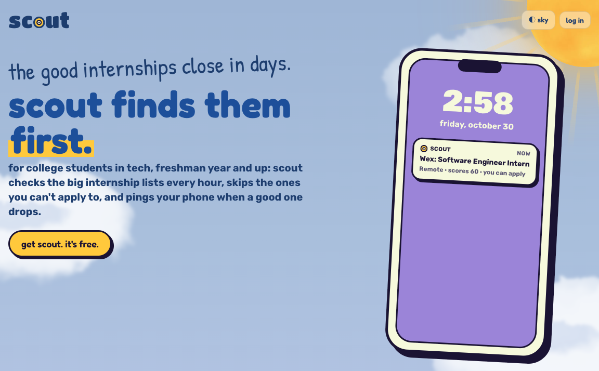
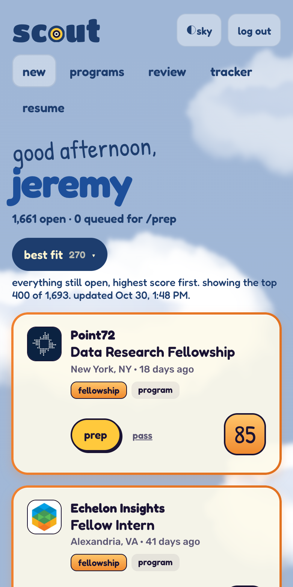
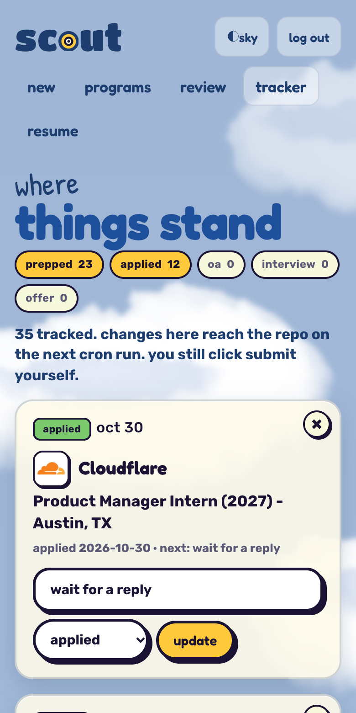
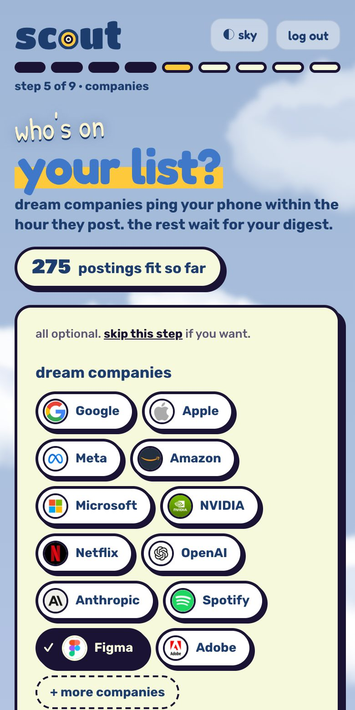

# Scout

An internship radar for college students in tech, freshman year and up. Sign up at **[scout-dashboard.jeremysleman.workers.dev](https://scout-dashboard.jeremysleman.workers.dev/hello)**, answer a few questions, and Scout checks the big internship lists (Simplify, intern-list.com's, and more) every hour, rules out the postings you can't apply to, ranks the rest for you, and pings your phone when a good one drops.



<p align="center">
  
  
  
</p>

**You always click Submit yourself.** Scout never applies for you, never logs into a job site, and never makes anything up about you. It finds, ranks, alerts, and helps you prep.

It costs $0 to run: GitHub Actions (free for public repos), Cloudflare Workers, KV, and D1 on the free tier, and [ntfy](https://ntfy.sh) for phone alerts. No AI runs on Scout's side, so there are no API bills.

## What a student gets
- **Sign-up questions** about school, graduation date, work authorization, fields, places, and companies (picked from logos). Required answers are marked; everything else can be skipped and changed later.
- **Their own New page**, greeting them by time of day: every posting judged for their graduation year, degree, and class standing, scored from their answers, with views for best fit, new today, new this week, big hitters, freshman friendly, near you, and what was ruled out and why.
- **A tracker** from saved to offer, with a prep prompt for each posting: paste it into your own Claude Code (or Claude) with your resume to tailor it. Your resume never comes to Scout.
- **Phone alerts** through their own private ntfy topic: strong matches within the hour, or one digest a day or week, never during their quiet hours.
- **Their data, their call:** download everything, delete the account, and a plain [privacy page](https://scout-dashboard.jeremysleman.workers.dev/privacy). Forgot your password? The reset link goes to your phone.

## How it works

```
GitHub Actions, every hour (Python)
  fetch the lists (Simplify, vanshb03, Jobright), hand-picked company boards, and a rotating batch of the
  ~1,100 Greenhouse, Lever, Ashby, and SmartRecruiters boards the lists link to -> normalize -> dedupe -> filter -> score
  -> read each posting page once and save its facts (graduation windows, degree level, class standing, closed)
  -> upload to the Worker
            |
            v
Cloudflare Worker (JavaScript, free tier)
  KV: the shared postings, logos, the owner's tracker
  D1: student accounts, answers, saved and passed postings, trackers, alert history
  every request: judge and score the shared postings for this student (worker/src/match.js)
  every 10 minutes: phone alerts for a few students per run, inside the free CPU limit
```

- **Read once, judged for everyone.** A posting page is read once into facts, and each student's verdict comes from those facts and their answers. The JavaScript verdict is checked against 600 cases generated by the Python rules, so the two can't drift.
- **Eligibility from the posting itself.** Scout reads Workday, Google Careers, Greenhouse, Lever, Ashby, Eightfold, Amazon, SmartRecruiters, Jobvite, iCIMS, Jobright, and more for graduation-year, degree, and class-standing rules, and labels postings that have been taken down.
- **Scoring without AI.** Role, company (your dream list first), built-for-freshmen, location, freshness, and your own keywords. Every card shows its math.
- **Security:** PBKDF2 passwords, sessions tied to the password, rate-limited logins that a stranger can't use to lock you out, same-origin POSTs only, security headers on every response, and every student query filtered by their id. The review checklist is in [docs/REVIEW-CHECKLIST.md](docs/REVIEW-CHECKLIST.md).

## Tech
- **Python 3.12** watcher in `scout/`: listings, matching, scoring, dedupe, eligibility, page watchers, alerts, sync. Standard library plus PyYAML.
- **Cloudflare Worker** in `worker/src/`: server-rendered pages, no framework, no build step. `index.js` (routing, the owner's pages), `accounts.js` (sign-up, log in, the questions), `student.js` (the student app and alerts), `match.js` (pure matching logic), `landing.js`. Every color and size lives in `tokens.css`.
- **Tests:** 289 Python tests on saved fixtures (`.venv/bin/python -m unittest discover -s tests`) and JavaScript tests for matching, scoring, and alert timing (`cd worker && npm test`), plus end-to-end runs against `wrangler dev`.
- **Claude Code** for the owner's own prep kits (`.claude/commands/`).

## What changed in this release
- A new look: three themes that follow the time of day where you are (light with a sun, sky with drifting clouds, dark with a lighthouse sweeping its beam), cream glass cards, a handwritten greeting, and scores in a hand-drawn style. The ◐ button picks a theme. The sun and lighthouse were modeled in Blender ([worker/art/scene.py](worker/art/scene.py)). The brand is written up in [docs/BRAND.md](docs/BRAND.md).
- Cards say why a posting matters: a rainbow frame for a dream company, purple for a big hitter, orange for a freshman program or fellowship, and a "fresh!" strip of tape on anything new. Company names show in each company's own type.
- More postings: Jobright's daily lists (the ones on intern-list.com) and about 1,100 company job boards found in the lists' own links, read a rotating batch every hour.
- Opened to other students: accounts, the sign-up questions, each student's own matches, tracker, alerts, and prep prompt.
- A public landing page that explains why Scout exists, with live numbers from the last run.
- The New page's views moved into one dropdown, with a big hitters view; a time-of-day greeting.
- Contrast: text on the page colors is navy, and the big cream headline words carry a navy outline.
- A full bug review in three rounds, every finding fixed with a test where it could have one.

How every piece runs: [docs/operations.md](docs/operations.md). The plan for opening Scout up: [docs/multi-user-plan.md](docs/multi-user-plan.md). Design decisions and why: [docs/decisions.md](docs/decisions.md). Code borrowed from MIT and Apache projects is listed in [THIRD_PARTY_NOTICES.md](THIRD_PARTY_NOTICES.md).

I built it with help from Claude Code. MIT license.
